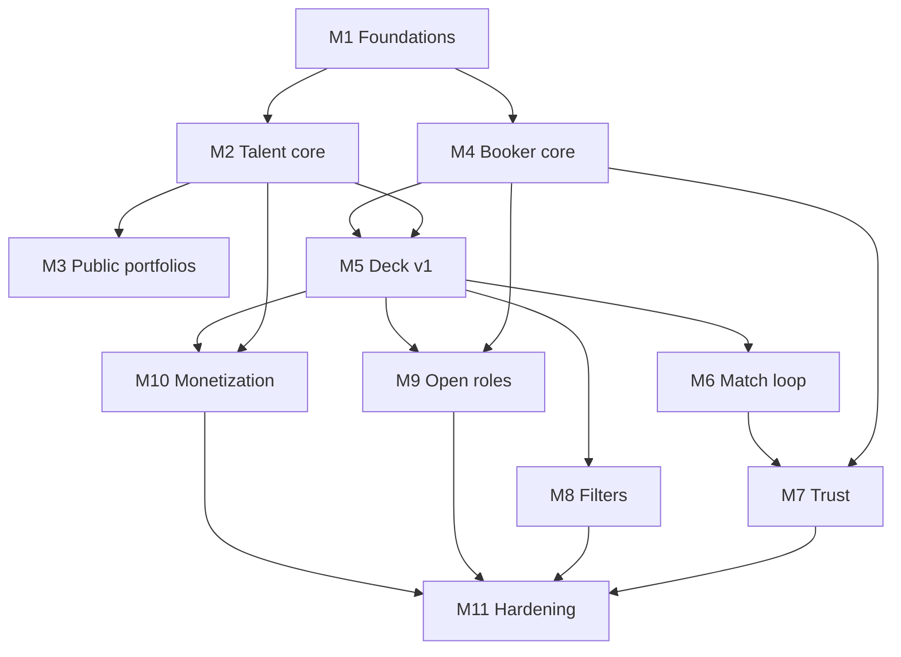

# Castly — Milestone plans

Ticket-level implementation plans for the build sequence in [TECH_SPEC.md](../TECH_SPEC.md) §24. One document per milestone. Numbers match the spec, with milestone 0 (deck spike) omitted by decision.

Each plan follows the same structure: goal, depends on, spec references, numbered tasks with acceptance criteria, exit gate, deferred work, and risks.

Work through a milestone's tasks in order. Do not start a later milestone until its listed dependencies have passed their exit gates.

## Cut line

A first release is **milestones 1–7**: a talent can build and publish a portfolio, a verified booker can discover and shortlist them, and both can talk. Filters, open roles, and Pro are additive and do not change the architecture.

## Index

| # | Plan | Goal |
|---|------|------|
| 1 | [Foundations](01-foundations.md) | Monorepo, schema, auth, CI, Sentry |
| 2 | [Talent core](02-talent-core.md) | Studio, media pipeline, publish, search projection |
| 3 | [Public portfolios](03-public-portfolios.md) | SSR pages, OG tags, vanity URLs |
| 4 | [Booker core](04-booker-core.md) | Vertical profiling, projects, roles |
| 5 | [Deck v1](05-deck-v1.md) | Card, ranking, swipe, shortlists |
| 6 | [Match loop](06-match-loop.md) | Interests, matches, chat, notifications |
| 7 | [Trust](07-trust.md) | Verification gate, moderation, admin queues |
| 8 | [Filters](08-filters.md) | Filter UI, sensitive-tier guard, saved filters |
| 9 | [Open roles](09-open-roles.md) | Board, raise-a-hand, who's hiring |
| 10 | [Monetization](10-monetization.md) | Castly Pro, Paystack, entitlements |
| 11 | [Hardening](11-hardening.md) | Budgets, NDPA, CSAM, business alerts |

## Dependency graph

M3 can run in parallel with M4. M8, M9, and M10 can run in any order after their listed dependencies, but M11 waits for all of them plus M7.

## Device measurement gates

The deck spike was dropped. Two measurement gates recover most of its value without a throwaway prototype:

- **End of M2** — first render-cost reading of native section renderers on target hardware (2GB Android, throttled 3G).
- **Start of M5** — card and deck shell measured for swipe and scroll *before* the ranking engine is built. If §25 budgets are missed, decide then between relaxing them or the expand-on-tap fallback in TECH_SPEC §26.
